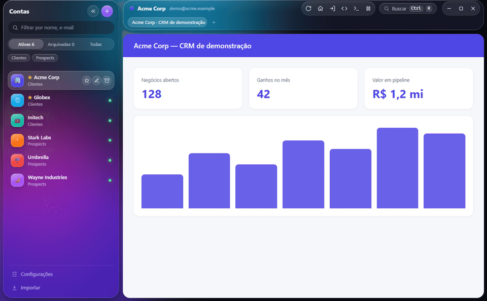
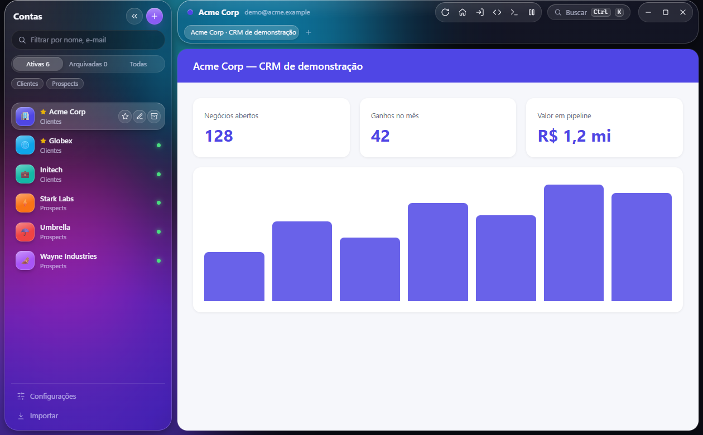
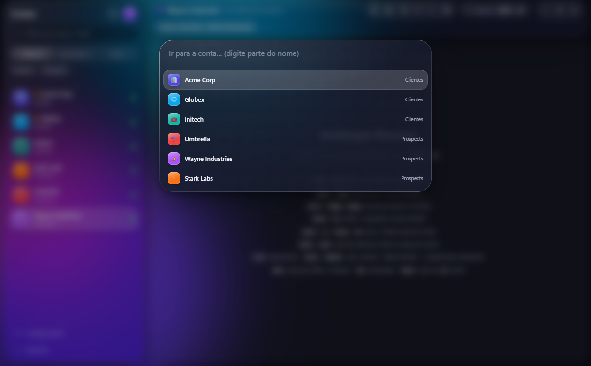

<div align="center">

# Multilogin Ploomes

**Alterne entre várias contas do Ploomes CRM com um clique, cada uma com sessão isolada.**
Sem aba anônima, sem guia de convidado, sem digitar e-mail e senha toda vez.




</div>

> As imagens deste README usam **contas e dados fictícios** (empresas inventadas e uma página local de demonstração). Nenhuma conta real aparece aqui.

## Para quem é

Quem atende vários clientes no Ploomes (consultoria, implantação, suporte) e vive trocando de login. Cada conta fica numa sessão própria, então os cookies de uma nunca vazam para outra e você não precisa sair e entrar de novo.

## O que faz

- **Sessão isolada por conta.** Cada conta tem sua própria partição do Chromium (`persist:acc-<id>`). Trocar de conta não derruba as outras.
- **Troca instantânea.** Um clique na barra lateral, ou `Ctrl+K` e digitar parte do nome.
- **Auto-login.** Detecta a tela de login e preenche e-mail e senha. Se aparecer o desafio da Cloudflare, você confirma na mão: o app não tenta contornar.
- **Várias abas por conta.** Todas dentro da mesma sessão, sem novo login. Links do Ploomes abrem como sub-aba.
- **Economia de memória.** A conta só carrega quando você clica e é suspensa após alguns minutos de inatividade. A sessão continua salva.
- **Organização.** Busca, tags, favoritas no topo e contas arquivadas (somem da lista sem apagar nada).
- **Notificações.** Contador de notificações por conta, lido do título da página.
- **Visual "Liquid Glass".** Painéis de vidro flutuantes, tema claro e escuro automáticos, janela sem moldura.
- **Chave de API opcional.** Guarda a chave de cada conta fora do `accounts.json` e testa se ela funciona.

<div align="center">


</div>

## Atalhos

| Atalho | Ação |
|---|---|
| `Ctrl` + `K` | Busca rápida de conta |
| `Ctrl` + `1…9` | Abre a n-ésima conta da lista |
| `Ctrl` + `Tab` | Volta para a conta anterior |
| `Ctrl` + `PgDn` / `PgUp` | Próxima / anterior da lista |
| `Ctrl` + `B` | Recolhe ou expande a barra lateral |
| `Ctrl` + `T` / `Ctrl` + `W` | Nova aba / fecha a aba da conta |
| `Ctrl` + `Alt` + `←` / `→` | Alterna entre as abas da conta |
| `Alt` + `←` / `→` | Voltar / avançar |
| `F5` | Recarrega |
| `Ctrl` + `+` / `-` / `0` | Zoom |
| `F12` | Inspecionar |

## Como rodar

Requisitos: [Node.js](https://nodejs.org/) em versão recente e Windows (o build portable é só para Windows).

```bash
npm install
npm run dev        # desenvolvimento, com hot reload
```

Outros comandos:

```bash
npm run typecheck  # checagem de tipos
npm test           # testes da lógica de pastas e chaves
npm run build      # compila para out/
npm run dist       # gera release/Multilogin-Ploomes-<versão>.exe (portable)
```

### Experimente sem usar contas reais

O app lê os dados da pasta apontada por `MULTILOGIN_DATA_DIR`. Crie uma pasta de teste com um `accounts.json` fictício e rode:

```bash
# PowerShell
$env:MULTILOGIN_DATA_DIR = "C:\caminho\da\pasta-de-teste"; npm run dev
```

Foi assim que as imagens acima foram geradas.

## Onde ficam os dados

| Modo | Pasta |
|---|---|
| Desenvolvimento | `data/` na raiz do projeto |
| Portable (`.exe`) | `data/` ao lado do executável |
| Qualquer um | a pasta de `MULTILOGIN_DATA_DIR`, se definida |

Dentro dela ficam o `accounts.json` e as sessões (cookies) de cada conta. Levar a pasta inteira para outro computador leva as contas já logadas.

## Segurança: leia antes de usar

- **As senhas ficam em texto puro** no `accounts.json`, sem criptografia. É uma decisão de projeto, não um descuido, mas qualquer pessoa com acesso ao arquivo vê as senhas.
- A pasta `data/` também guarda os **cookies de sessão** de cada conta. Quem copiar essa pasta entra nas contas.
- Por isso `data/` está no `.gitignore`. **Nunca** faça commit dela, nem de cópias de backup.
- A chave de API não vai para o `accounts.json`: fica em `<pasta de chaves>\<Nome>.txt` (padrão `%USERPROFILE%\.ploomes`). Só o processo principal lê o arquivo, e a interface nunca recebe a chave de volta.
- O teste de chave faz apenas `GET /Account`, sem seguir redirecionamento, para a chave não ser enviada a outro host.
- Contas com 2FA ou captcha não funcionam no envio automático. O app preenche e você finaliza.

## Estrutura

```
src/
  main/        processo principal: janela, sessões, abas, auto-login, armazenamento
  preload/     ponte segura entre o processo principal e a interface
  renderer/    interface em React (barra lateral, formulário, busca rápida, abas)
  shared/      tipos e constantes de layout compartilhados
tests/         testes da lógica de pastas e chaves
```

## Aviso

Projeto independente, sem vínculo com a Ploomes. "Ploomes" é marca de seus respectivos titulares. Use apenas com contas que você tem autorização para acessar.

## Licença

[MIT](LICENSE)
